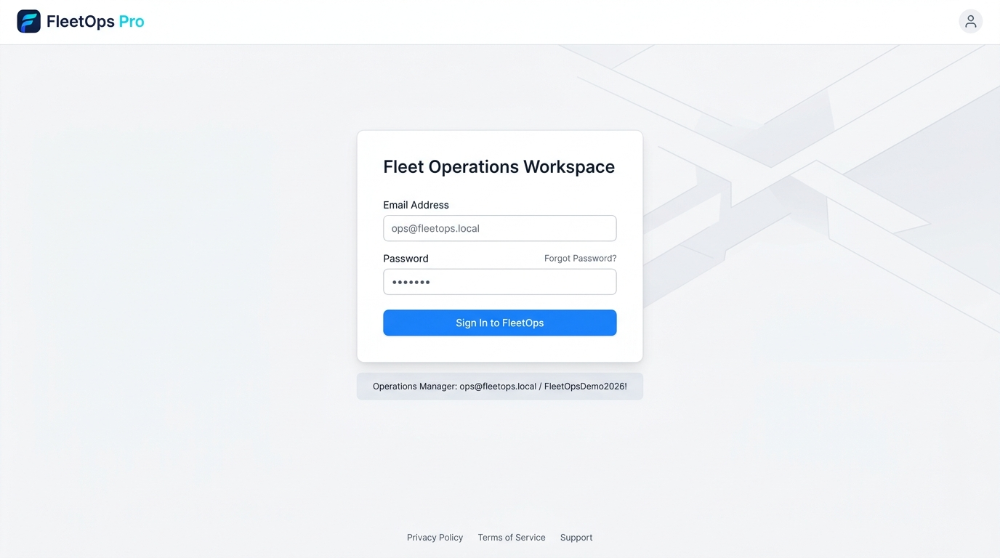
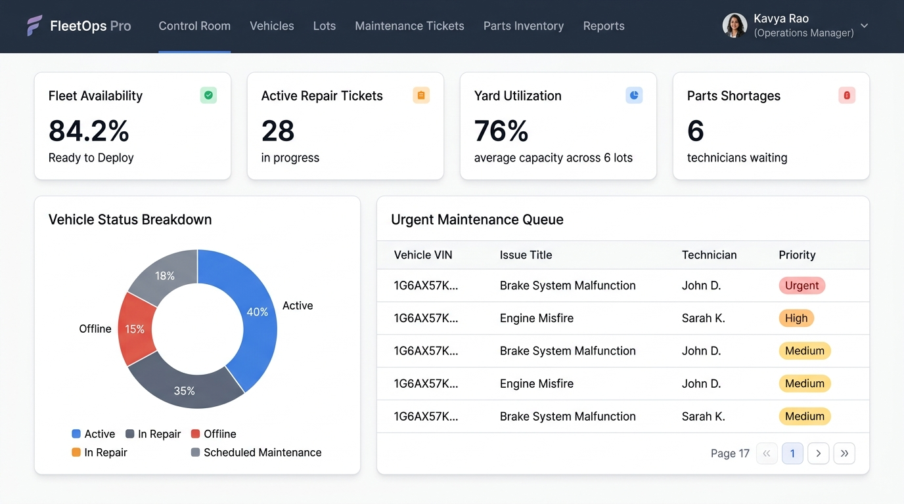
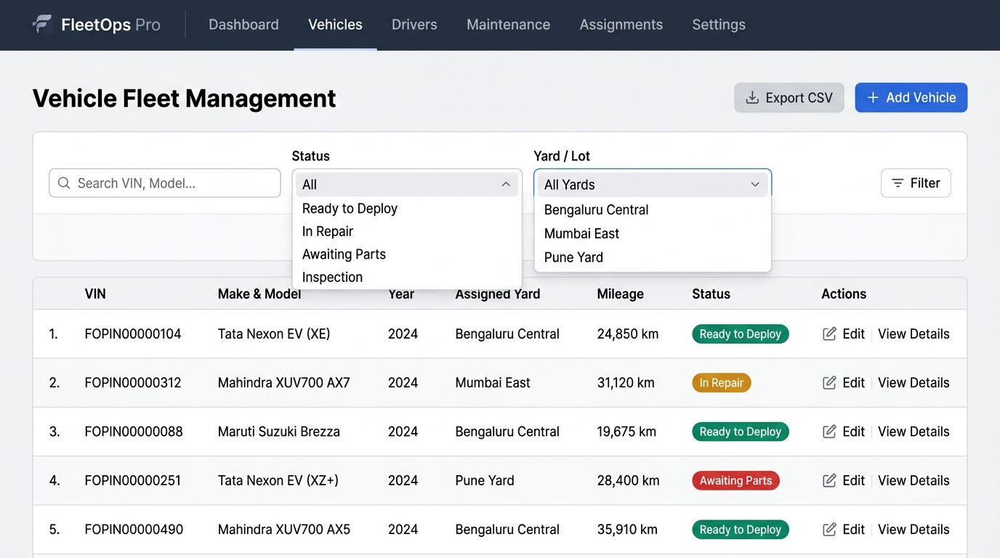
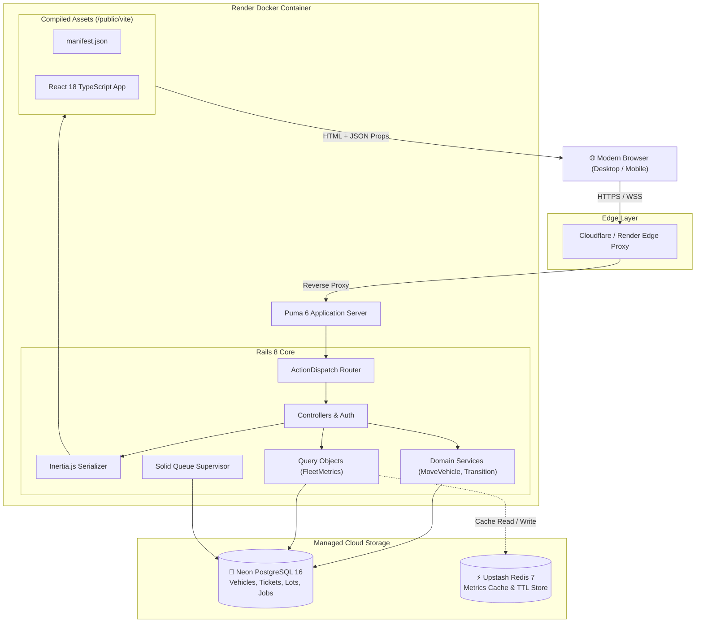
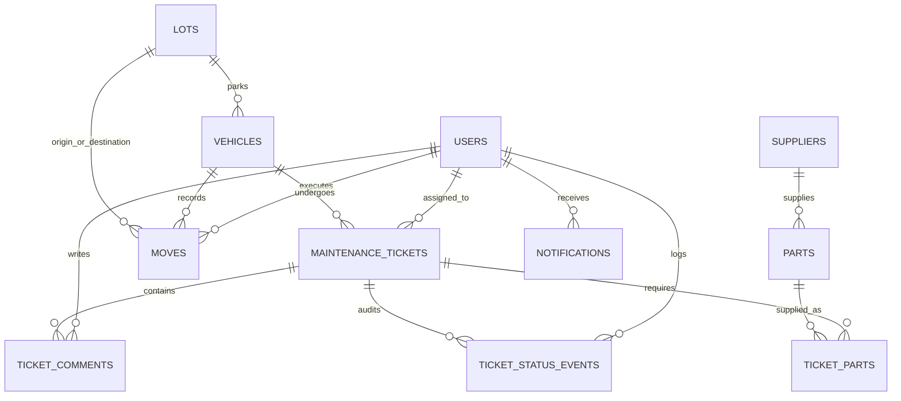

# FleetOps Pro — Fleet Operations Management Platform

[](https://github.com/Dhanya562004/fleetops-pro/actions/workflows/ci.yml)
[](https://www.ruby-lang.org/)
[](https://rubyonrails.org/)
[](https://react.dev/)
[](https://www.typescriptlang.org/)
[](https://www.postgresql.org/)
[](https://redis.io/)
[](https://tailwindcss.com/)
[](https://render.com/)
[](LICENSE)

> **FleetOps Pro** is an enterprise-grade fleet operations, maintenance workflow, and yard capacity management platform. It solves a fundamental logistics problem: **What is keeping a vehicle from returning to active service?**

---

## 🌐 Live Demo

- **Production URL**: [https://fleetops-pro.onrender.com](https://fleetops-pro.onrender.com)
- **Login Endpoint**: [https://fleetops-pro.onrender.com/session/new](https://fleetops-pro.onrender.com/session/new)
- **Health Check**: [https://fleetops-pro.onrender.com/up](https://fleetops-pro.onrender.com/up)

*Note: Hosted on Render Free tier with Neon Serverless PostgreSQL and Upstash Redis. If idle, the service automatically spins up within ~30–45 seconds upon initial access.*

---

## 📋 Table of Contents

- [Live Demo](#-live-demo)
- [Project Overview](#-project-overview)
- [Visual Showcase (Screenshots)](#-visual-showcase)
- [Key Features](#-key-features)
- [Tech Stack](#-tech-stack)
- [System Architecture](#-system-architecture)
- [Demo Credentials](#-demo-credentials)
- [Local Setup & Installation](#-local-setup--installation)
- [Production Deployment](#-production-deployment)
- [Testing & Quality Assurance](#-testing--quality-assurance)
- [How Concurrency is Handled](#-how-concurrency-is-handled)
- [Author & Acknowledgments](#-author)

---

## 🚀 Project Overview

Commercial fleet operators often struggle with operational bottlenecks where vehicle readiness, maintenance queues, yard storage limits, technician allocations, and spare parts shortages are siloed across disconnected tools.

**FleetOps Pro** unifies these critical operations into a unified, high-performance control plane:
- **Real-Time Fleet Readiness**: Monitors operational vehicle availability, in-repair status, and vehicles awaiting parts across multiple regional depot yards.
- **Strict Repair State Graph**: Enforces compliant maintenance progressions (`inspection` &rarr; `repair` &rarr; `quality_check` &rarr; `ready`) with complete audit trails.
- **Shortage Correlation**: Directly links missing spare parts to blocked maintenance tickets and stalled vehicles.
- **Yard & Lot Capacity Management**: Tracks lot utilization in real time and enforces atomic vehicle transfers with locking to prevent overcrowding.
- **Executive SQL Reporting**: Delivers zero-latency operational metrics and breakdown reports using PostgreSQL window functions and short-lived Redis caching.

---

## 📸 Visual Showcase

### 1. Operations Workspace Login
Secure authentication interface supporting multi-role access (Admin, Operations Manager, Technician) with pre-filled demo capabilities.



### 2. Fleet Control Room & Operations Dashboard
Real-time control room surfacing fleet availability KPIs, active repairs, yard utilization percentages, parts shortages, and urgent maintenance queues.



### 3. Vehicle Fleet & Lot Management
Comprehensive fleet directory supporting multi-criteria search, status filtering, yard allocation, detailed vehicle history, and streaming CSV export.



---

## ✨ Key Features

### 🚗 1. Vehicle Readiness & Fleet Tracking
- Unified fleet directory with search by VIN, Make, Model, and Year.
- Status filters: `Ready to Deploy`, `In Repair`, `Inspection Pending`, `Awaiting Parts`, `In Transit`, and `Out of Service`.
- Paginated table with instant lot-level status badges and streaming CSV export.

### 🛠️ 2. Maintenance & Repair Workflow Engine
- State machine workflow: strictly guards state transitions (`inspection` &rarr; `repair` &rarr; `quality_check` &rarr; `ready` / `cancelled`).
- Detailed ticket audit trails (`TicketStatusEvent`) capturing timestamps, notes, and user IDs.
- Technician assignment with workload tracking and estimated vs. actual repair hours.

### 📦 3. Parts Inventory & Shortage Management
- Supplier and SKU directory with real-time stock thresholds and unit costing.
- Correlates zero-stock or depleted parts with blocked maintenance tickets.
- Dedicated **Parts Shortages** view identifying blocked technicians awaiting supplier fulfillment.

### 📍 4. Multi-Depot Yard & Lot Capacity
- Regional yard tracking across major transportation hubs (e.g., Bengaluru, Mumbai, Pune, Delhi NCR, Hyderabad, Chennai).
- Atomic vehicle transfers (`Lots::MoveVehicle`) with pessimistic row locking preventing overcapacity transfers.
- Visual lot occupancy percentage indicators with full-lot alerts.

### 📊 5. Analytical Intelligence & Reports
- Complex analytical queries using PostgreSQL CTEs and window functions.
- 5-minute Redis-cached operational snapshots (`FleetMetricsQuery`).
- Key metrics: Average turnaround time, availability percentages, shortage delay durations, and technician efficiency.

### ⚡ 6. Workshop Activity Live Feed
- Server-rendered Hotwire Turbo + Stimulus screen for real-time workshop activity without React bundle overhead.

---

## 🛠️ Tech Stack

| Layer | Technologies | Description |
| :--- | :--- | :--- |
| **Backend Framework** | **Ruby on Rails 8.0** | Modern Rails API and controllers with Solid Queue, Zeitwerk, and Puma |
| **Frontend Architecture** | **Inertia.js + React 18** | Monolithic routing simplicity with rich client-side React single-page experience |
| **Language & Typings** | **TypeScript 5.7** | Strict type safety for all components, Inertia page props, and API models |
| **Asset Pipeline** | **Vite Ruby + Vite 8** | Sub-second HMR dev server and optimized production rollup asset bundling |
| **Styling & Design** | **Tailwind CSS 3.4** | Enterprise design system with responsive layouts and custom status palettes |
| **Primary Database** | **PostgreSQL 16 (Neon)** | ACID transactions, foreign keys, check constraints, composite indexes, and CTEs |
| **Caching Layer** | **Redis 7 (Upstash)** | High-throughput distributed key-value cache with TLS connection (`rediss://`) |
| **Background Jobs** | **Solid Queue 1.0** | PostgreSQL-backed job processing supervised inside Puma |
| **Containerization** | **Docker (Multi-stage)** | Lightweight production container (`ruby:3.4-slim`) with static asset precompilation |
| **Deployment / Host** | **Render Web Service** | Automated continuous deployment with health checks on `/up` |

---

## 🏗️ System Architecture

### High-Level Topology



### Entity Relationship Model



---

## 🔑 Demo Credentials

FleetOps Pro is pre-seeded with realistic, idempotent enterprise test data across 60 technicians, 300 vehicles, 150 parts, and 800 maintenance records.

| Role | Email | Password | Permissions & Scope |
| :--- | :--- | :--- | :--- |
| **Operations Manager** | `ops@fleetops.local` | `FleetOpsDemo2026!` | Full control room access, vehicle reallocation, ticket management, and analytics |
| **Administrator** | `admin@fleetops.local` | `FleetOpsDemo2026!` | User administration, configuration, audit logs, and data quality tools |
| **Technician** | `technician1@fleetops.local` | `FleetOpsDemo2026!` | Assigned repair tickets, status updates, part requests, and notes |

---

## 💻 Local Setup & Installation

### Option A: Using Docker Compose (Recommended)

1. **Clone the repository**:
   ```bash
   git clone https://github.com/Dhanya562004/fleetops-pro.git
   cd fleetops-pro
   ```

2. **Configure environment variables**:
   ```bash
   cp .env.example .env
   ```

3. **Start services**:
   ```bash
   docker compose up --build
   ```

4. **Access the application**:
   - Web App: [http://localhost:3000](http://localhost:3000)
   - Vite Dev Server: [http://localhost:5173](http://localhost:5173)

---

### Option B: Native Host Development

#### Prerequisites
- **Ruby**: `>= 3.4.0` (with Bundler 2.6+)
- **Node.js**: `>= 22.0.0` (with npm 10+)
- **PostgreSQL**: `16.x`
- **Redis**: `7.x`

#### Steps

1. **Clone and install dependencies**:
   ```bash
   git clone https://github.com/Dhanya562004/fleetops-pro.git
   cd fleetops-pro

   # Install Ruby gems
   bundle install

   # Install Node packages
   npm ci
   ```

2. **Environment configuration**:
   ```bash
   cp .env.example .env
   # Ensure DATABASE_URL and REDIS_URL point to your local instances
   ```

3. **Database initialization & seeding**:
   ```bash
   bundle exec rails db:prepare
   bundle exec rails db:seed
   ```

4. **Start the development servers**:
   In terminal 1 (Vite HMR):
   ```bash
   npm run dev
   ```

   In terminal 2 (Rails Web Server):
   ```bash
   bundle exec rails server -p 3000
   ```

5. Open [http://localhost:3000](http://localhost:3000) in your browser.

---

## 🚀 Production Deployment

FleetOps Pro is deployed on Render using a modern cloud architecture:

### 1. Cloud Infrastructure
- **Web Service**: [Render](https://render.com) (Docker Runtime, Free Tier)
- **Database**: [Neon](https://neon.tech) (Serverless PostgreSQL 16 with Connection Pooling)
- **Cache**: [Upstash](https://upstash.com) (Serverless Redis 7 over TLS)

### 2. Multi-Stage Dockerfile Strategy
The production [Dockerfile](Dockerfile) utilizes a clean two-stage build:
- **Build Stage (`ruby:3.4-slim` + Node.js 22)**: Bundles production gems and runs `npm run build` to compile TypeScript and Vite assets into `public/vite/`.
- **Runtime Stage (`ruby:3.4-slim`)**: Contains only the Ruby runtime and system libraries (`libpq5`, `ca-certificates`). Node.js and npm are excluded, reducing the container footprint.

### 3. Key Production Environment Variables
| Variable | Description |
| :--- | :--- |
| `RAILS_ENV` | Must be `production` |
| `SECRET_KEY_BASE` | Secure Rails secret key base |
| `DATABASE_URL` | Neon pooled PostgreSQL connection string with SSL (`sslmode=require`) |
| `REDIS_URL` | Upstash Redis connection string with TLS (`rediss://...`) |
| `RAILS_SERVE_STATIC_FILES` | Set to `true` to serve precompiled Vite assets via Puma |
| `RAILS_LOG_TO_STDOUT` | Set to `true` to stream logs directly to Render log viewer |
| `SOLID_QUEUE_IN_PUMA` | Set to `true` to run background jobs within Puma |
| `SEED_ON_BOOT` | Set to `true` on initial deployment to auto-seed demo accounts |

---

## 🧪 Testing & Quality Assurance

The codebase enforces strict continuous integration standards via GitHub Actions, covering backend domain services, state machines, query caching, pessimistic concurrency, frontend React components, linters, and type checking.

### Test Execution Commands & Verified Metrics

| Test Suite / Checker | Tool | Command | Verified Metrics & Status |
| :--- | :--- | :--- | :--- |
| **Backend Tests** | Minitest 6 | `bundle exec rails test` | **33 runs, 343 assertions, 0 failures, 0 errors, 0 skips** (✅ Passed) |
| **Backend Coverage** | SimpleCov 1.3 | Integrated in `test_helper.rb` | **63.70% line coverage (272 / 427 lines)** |
| **Frontend Tests** | Jest 29 + RTL | `npm test -- --ci` | **1 test suite passed, 1 test passed (1 total)** (✅ Passed) |
| **Ruby Code Style** | RuboCop Omakase | `bundle exec rubocop` | **70 files inspected, 0 offenses detected** (✅ Clean) |
| **Frontend Linting** | ESLint 8 | `npm run lint` | **0 errors, 0 warnings** across `resources/js` (✅ Clean) |
| **Type Checking** | TypeScript 5.7 | `npm run type-check` | **`tsc --noEmit` exited 0, 0 type errors** (✅ Clean) |
| **Production Build** | Vite 8 | `npm run build` | **Asset compilation succeeded into `public/vite/`** (✅ Clean) |

```bash
# 1. Ruby code style and conventions (70 files inspected, 0 offenses)
bundle exec rubocop

# 2. Rails backend tests (33 runs, 343 assertions, 0 failures, 63.70% line coverage)
bundle exec rails test

# 3. TypeScript static analysis (0 errors)
npm run type-check

# 4. Frontend ESLint checks (0 errors, 0 warnings)
npm run lint

# 5. React component tests (1 passed, 1 total)
npm test -- --ci

# 6. Production Vite asset compilation check
npm run build
```

### GitHub Actions CI Workflow
- Executes on every Pull Request and push to `main`.
- Boots managed PostgreSQL 16 and Redis 7 service containers with health checks.
- Runs linters, Minitest suite, Jest suite, TypeScript type-check, and Vite production bundle compilation.
- Publishes an automated execution and coverage summary directly to `$GITHUB_STEP_SUMMARY`.
- Automated health check workflow (`keepalive.yml`) polls `/up` every 10 minutes.

---

## 🔒 How Concurrency is Handled

FleetOps Pro operates in high-volume depot environments where multiple dispatchers, technicians, and automated background jobs may simultaneously update vehicle locations, change maintenance states, or query operational analytics. Concurrency safety is enforced at the database and application layers:

### 1. Pessimistic Row Locking (`SELECT ... FOR UPDATE`)
- **Deterministic Lock Ordering**: When transferring a vehicle between lots (`Lots::MoveVehicle`), row-level exclusive locks are acquired via `Lot.where(id: lot_ids).order(:id).lock`. Sorting lot IDs deterministically (`[vehicle.lot_id, to_lot.id].compact.uniq.sort`) guarantees that reciprocal moves (e.g., Lot A &rarr; Lot B and Lot B &rarr; Lot A) acquire locks in identical order, eliminating database deadlocks.
- **Vehicle Locking**: The vehicle itself is locked (`Vehicle.lock.find(@vehicle_id)`) to prevent simultaneous transfer requests for the same vehicle across concurrent sessions.

### 2. Yard Capacity Invariant Under Race Conditions
- **Serialized Capacity Checks**: The transfer occurs inside a single database transaction (`Move.transaction`). Because the destination lot row is exclusively locked, any concurrent transaction attempting to transfer into that lot is queued until the first transaction commits or rolls back.
- **Strict Capacity Guard**: The service evaluates `destination.vehicles.count >= destination.capacity` under the lock. If $N$ threads race to move vehicles into a lot with only one space remaining:
  1. The first thread acquires the lock, observes space available, inserts the `Move` audit record, updates `vehicle.lot_id`, and commits.
  2. The remaining $N - 1$ threads acquire the lock sequentially, observe that `destination.vehicles.count` is now equal to `destination.capacity`, and immediately abort with `Lots::MoveVehicle::CapacityExceeded`.
  3. The destination lot count **never exceeds capacity**.

### 3. Concurrency Test Architecture (`use_transactional_tests = false`)
- **Why Transactional Tests Must Be Disabled**: Rails default tests run inside an uncommitted database transaction rolled back at test completion. Because PostgreSQL isolates uncommitted data across connections, separate OS threads checking out independent pool connections cannot observe uncommitted test fixtures, and real PostgreSQL `FOR UPDATE` lock contention cannot be tested.
- **Thread Race Verification**: In `Lots::MoveVehicleConcurrencyTest`, `self.use_transactional_tests = false` allows $N$ worker threads to check out true database connections from the ActiveRecord connection pool, synchronize on a `ConditionVariable` barrier, and race simultaneously against real PostgreSQL row locks.
- **Deterministic Teardown**: Because non-transactional changes commit to the test database, an explicit `teardown` block deletes all generated `Move` records, vehicles, and lots after each run.

### 4. Workflow State Machine Serialization
- In `Maintenance::Transition`, status advancements execute within `MaintenanceTicket.transaction` while holding an exclusive row lock (`MaintenanceTicket.lock.find(@ticket_id)`). This guarantees that concurrent updates, part fulfillment checks, and vehicle status synchronizations are strictly serialized.

---

## 👩‍💻 Author

**Dhanya k**
- **GitHub**: [@Dhanya562004](https://github.com/Dhanya562004)
- **Project Repository**: [https://github.com/Dhanya562004/fleetops-pro](https://github.com/Dhanya562004/fleetops-pro)
- **Live Demo**: [https://fleetops-pro.onrender.com](https://fleetops-pro.onrender.com)

---

## 📄 License

This project is licensed under the [MIT License](LICENSE).
