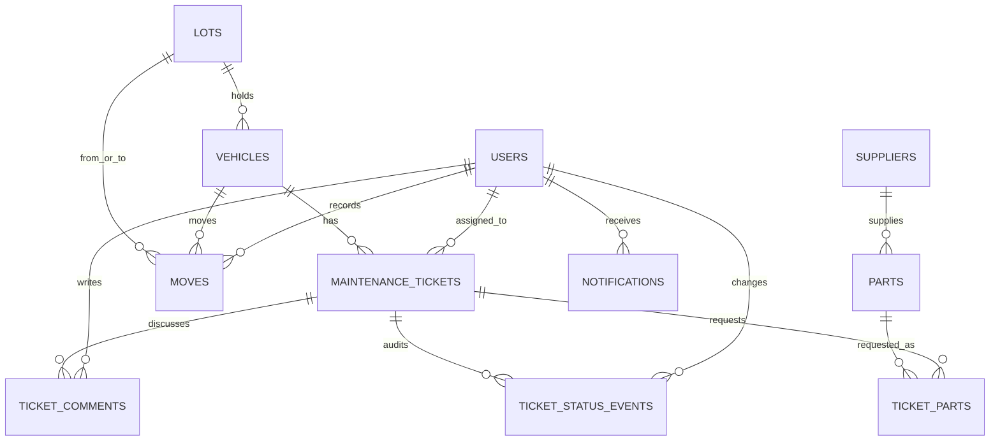

# FleetOps Pro

FleetOps Pro is a fictional internal fleet operations tool built around a practical question: what is keeping a vehicle from returning to service? It connects vehicle readiness, lot capacity, repair work, technician assignments, parts shortages, and operational reporting in one Rails + React application.

This repository is a portfolio project. It contains fictional Indian-market fleet data only and is not affiliated with a fleet company. The public GitHub repository was requested as `https://github.com/Dhanya562004/fleetops-pro`; no live deployment URL is claimed until a host, database, Redis service, and credentials are configured.

## Product Views

- **Fleet control room** - availability, urgent tickets, lot pressure, and an explicit technician-waiting-on-part count.
- **Vehicles** - add/edit/detail, status and lot filters, search, pagination, and CSV export.
- **Lot capacity** - occupancy, full-lot warnings, and audited vehicle transfers.
- **Repair tickets** - assignment, allowed status transitions, audit history, comments, and part requests/fulfillment.
- **Parts shortages** - low-stock parts connected to blocked tickets.
- **Technician dashboard** - grouped open work and workload indicators.
- **Fleet reports** - SQL-backed availability, repair duration, downtime, shortage waiting time, and status counts.
- **Workshop activity** - one deliberately server-rendered Turbo/Stimulus screen.

Screenshots are not included yet: a database-backed browser session is required to capture truthful populated screens. The pages and interactions are built in `resources/js/pages` and `app/views`.

## Tech Stack

| Layer | Technology |
| --- | --- |
| Runtime | Ruby 3.4, Rails 8, PostgreSQL |
| Web UI | React 18, TypeScript, Inertia Rails, Vite, Tailwind CSS |
| Legacy page | Hotwire Turbo + Stimulus |
| Cache | Redis through `Rails.cache` |
| Jobs | Solid Queue, optionally supervised in Puma |
| Tests | Minitest; Jest + React Testing Library |
| Quality / delivery | RuboCop, ESLint, GitHub Actions, Docker Compose |

## Data Model



`vehicles` own the current fleet state; `moves` preserve transfer history. `maintenance_tickets` hold repair work, `ticket_status_events` are the audit trail, and `ticket_parts` express requested versus fulfilled quantities. `legacy_import_rows` stores malformed external payloads for investigation without weakening constraints on live tables. `notifications` use unique idempotency keys; `analytics_snapshots` preserve daily aggregates. Solid Queue tables are separate infrastructure tables in the same PostgreSQL database.

Foreign keys protect references. Unique indexes protect user email, VIN, supplier/part identifiers, ticket-part pairs, snapshot dates, and job idempotency. Check constraints enforce enum-like status/role values, positive lot capacity, nonnegative mileage and stock, and valid requested/fulfilled quantities. Composite indexes support the fleet status/lot view and ticket queues by status, priority, technician, and vehicle. See the migration for exact definitions.

## Run Locally

Requirements: Docker Desktop (or Docker Engine with Compose), Git, and a browser. Docker is not installed in the current development environment, so `docker compose up` has not been verified here.

```sh
cp .env.example .env
docker compose up --build
```

Open `http://localhost:3000`. Compose starts PostgreSQL and Redis, applies migrations, seeds fictional data on boot, and starts Rails with Solid Queue in the Puma process. Seed creation is idempotent. The compose password and secret are development-only; never reuse them for a public deployment.

Demo accounts (password for all: `FleetOpsDemo2026!`):

| Role | Email |
| --- | --- |
| Admin | `admin@fleetops.local` |
| Ops manager | `ops@fleetops.local` |
| Technician | `technician1@fleetops.local` |

For direct local development, install Ruby 3.4 and Node 22, start PostgreSQL and Redis, copy `.env.example` to `.env`, install dependencies with `bundle install` and `npm ci`, then run `bundle exec rails db:prepare`, `bundle exec rails db:seed`, `npm run dev`, and `bundle exec rails server` in separate terminals. Set `DATABASE_URL` to the test database before running Rails tests.

## Checks

```sh
bundle exec rubocop
bundle exec rails test
npm run type-check
npm run lint
npm test -- --ci
npm run build
```

The React suite currently contains one component test. Backend tests cover models, workflow services, data-quality quarantine, notifications, CSV export, and role access. Backend test execution is pending a working local PostgreSQL service; no Minitest pass count is claimed here.

## Operational Problems Mapped to Code

| Operational problem | Implementation |
| --- | --- |
| A lot is full | `Lots::MoveVehicle` locks both lots and rejects a transfer at capacity. |
| A technician is waiting on a part | Part shortage changes ticket and vehicle state; the dashboard and shortage report surface it. |
| Repair steps happen out of order | `Maintenance::Transition` enforces the workflow graph and writes status events. |
| A report is too slow or hard to verify | `FleetMetricsQuery` uses PostgreSQL CTEs/window functions and a short Redis cache. |
| A reminder or alert retries | `NotificationProcessingJob` uses a unique idempotency key. |
| Legacy imports contain bad data | `LegacyImportRow` stores raw anomalies; `data_quality:investigate` quarantines them. |

## Project Notes

- [Architecture for a new teammate](docs/ARCHITECTURE.md)
- [Production data investigation exercise](docs/DATA_INVESTIGATION.md)
- [Performance measurement and current status](docs/PERFORMANCE.md)
- [Interview walkthrough](docs/WALKTHROUGH.md)
- [Git workflow and merge-conflict exercise status](docs/GIT_WORKFLOW.md)
- [Deployment steps and current free-tier limits](docs/DEPLOYMENT.md)
- [ADR: Inertia Rails](docs/adr/0001-inertia-rails.md)
- [ADR: service objects](docs/adr/0002-service-objects.md)
- [ADR: Solid Queue](docs/adr/0003-solid-queue.md)
- [ADR: caching strategy](docs/adr/0004-caching.md)
- [Pull request template](.github/pull_request_template.md)

## CI and Deployment Status

GitHub Actions is configured for pull requests and pushes to `main`, with PostgreSQL and Redis service containers. A scheduled `/up` ping workflow uses the repository variable `DEMO_BASE_URL`. CI status and live URLs will be added only after the repository is pushed and the workflow/deployment has actually run.
